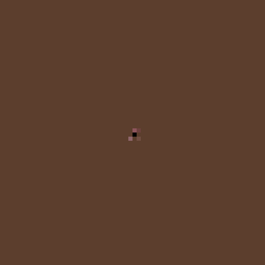
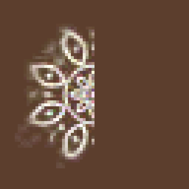
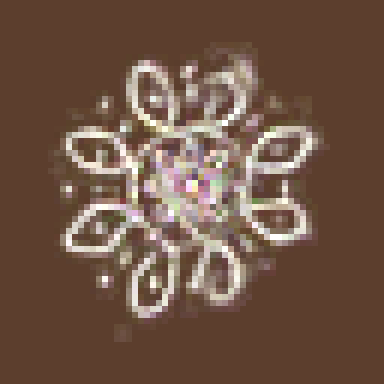

# Kolam NCA: a kolam that grows and heals itself

A **Neural Cellular Automaton (NCA)** that grows an original kolam design from a single cell, and rebuilds it after half of it is cut away. Every pixel runs the same tiny neural network, which sees only its 8 neighbours. Nobody draws the kolam: it emerges from purely local rules.

Trained entirely on a **laptop CPU**, across several short sessions.



| Target | Grown from one cell | Right half cut away | Regrown |
|---|---|---|---|
|  |  |  |  |

---

## How it works

**The canvas.** A 64 × 64 grid of cells. Each cell holds 16 numbers: red, green, blue, alpha ("how alive am I") and 12 hidden channels that cells use to signal each other. At the start, everything is zero except one living, colourless cell in the centre.

**One step, for every cell at once:**
1. **Look.** Each cell reads its own 16 values plus two Sobel filters (how values change left-to-right and top-to-bottom) over its 3 × 3 neighbourhood: 48 numbers in total.
2. **Think.** A tiny network (48 → 96 → 16, about 6,300 parameters) turns those 48 numbers into a change for each of its 16 values.
3. **Coin flip.** Only about half the cells apply their change at each step, so the rule must work without perfect synchronisation.
4. **Alive check.** A cell with no living neighbour is reset to zero, so life can only spread outwards from existing life.

**Training.** Grow for 67–86 steps, compare the visible channels (RGB + alpha) with the target using mean squared error, backpropagate through all the steps, and update the shared network. The cells never see the target; it is used only as the answer key.

**Three tricks** (from Mordvintsev et al., 2020):
- **Sample pool:** training often continues from already-grown patterns, so the kolam stays stable over long runs instead of falling apart.
- **Fresh seeds:** the worst sample in each batch is replaced by a new seed, so growing from scratch is always practised.
- **Damage:** grown patterns are deliberately damaged so the rule learns to repair them.

## The kolam

An original design drawn in code (`make_bold_kolam`): a centre flower of eight petals, a ring, eight large outer petals each holding a dot, and rows of dots between them. White lines on a dark floor, like a rice-flour kolam.

It was designed for the resolution the model can learn on a CPU: **48 × 48 pixels** (64 × 64 with an empty border). An earlier, much more intricate mandala design collapsed into a blurry disc at trainable sizes, so the lines here are deliberately bold.

## Training

| Stage | Iterations | Learning rate | Damage | Purpose |
|---|---|---|---|---|
| 1 | 0 → 3,000 | 0.002, then 0.0002 from 2,100 | small circular bites, after iteration 750 | grow and keep the kolam |
| 2 | 3,000 → 3,500 | 0.0005, then 0.00005 from 3,350 | circular bites **or** a whole half cut away | rebuild large missing parts |

Batch size 4, CPU only, about 4 seconds per iteration: roughly 4 hours in total, run in several sessions using the checkpoint and resume feature.

**Why stage 2 was needed.** After stage 1 the kolam grew well, but when half of it was cut away it grew back as a tangle. The reason: stage 1 only ever damaged small circles (radius 8–16 pixels), while the test removes a whole half, far larger than anything seen in training. Adding half-cuts to the training damage fixed the mismatch.

**Loss.** An empty canvas scores 0.096 against this target. By the end of stage 1 the loss was 0.009–0.017, roughly 82–91% of the error removed. Stage 2 losses are higher (0.012–0.030) because half of every batch starts with a large part of the kolam erased; they are not comparable with stage 1.

## Run it yourself

```bash
pip install torch numpy pillow

python nca_kolam.py --preview                  # save the target kolam to out/target.png
python nca_kolam.py --iters 3000               # stage 1 (Ctrl+C saves; rerun to continue)
python nca_kolam.py --iters 3500 --lr 0.0005   # stage 2: continue with half-cut damage
python nca_kolam.py --demo                     # make the grow-and-regrow GIF from the latest checkpoint
```

Note: the current script always includes half-cut damage. To reproduce stage 1 exactly, use circular damage only for the first 3,000 iterations.

## Limitations

- **Low resolution.** At 48 × 48 pixels, edges are soft; fine detail is not possible at this size on a CPU.
- **One model, one kolam.** The trained rule grows only this design. Growing different kolams from one rule would need a "genome" code in the seed (conditional NCAs).
- **Imperfect repair.** The regrown kolam is recognisable but softer than the original.
- **Single training run.** No repeated runs with different random seeds.

## What is new here

The method is Mordvintsev et al. (2020). This project contributes an original kolam target designed for low resolution, CPU-only training split across sessions, and a demonstration that mismatched damage during training (small bites vs. half-cuts) explains poor large-scale repair.

## Reference

Mordvintsev, A., Randazzo, E., Niklasson, E., & Levin, M. (2020). Growing Neural Cellular Automata. *Distill*. https://distill.pub/2020/growing-ca/

## Author

Fathima Fiya K M
